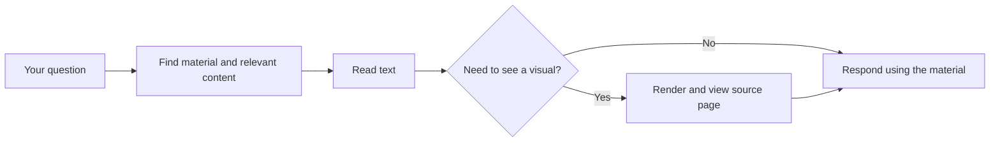
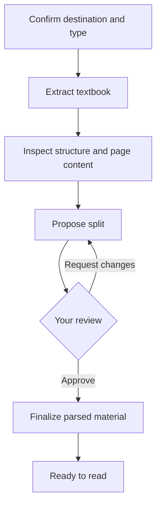

# Course material parser

**English** | [繁體中文](README.zh-TW.md)

A local agent skill for reading course textbooks and lecture slides—including the
pages, diagrams, and formulas you want to discuss.

## 🌟 Highlights

- **Read what you need.** Navigate textbooks by chapter or reading unit, and slides
  by source page, without loading the entire PDF into the conversation.
- **See the page, not just its text.** The agent can render source pages as images
  to examine diagrams, charts, and other visuals alongside the parsed content.
- **Build a reusable course library.** Parse PDFs once, then return to the stored
  material for later questions and study sessions.
- **Keep processing local.** PDF conversion and page rendering run on your machine;
  parsing needs no network after model setup.

## ℹ️ Overview

This skill helps your agent work with course material: find a textbook or slide deck,
read the relevant content, and inspect source pages when a visual matters. It uses
[Docling](https://github.com/docling-project/docling) to turn source PDFs into parsed
material with text, structure, and references to visuals. Textbooks are organized into
chapters and reading units with your approval; slides remain readable by source page.

## 🚀 Usage

After installation, ask your agent about material in your library:

> Read section 1.1 of my economics textbook and explain how income shifts demand.

> Show me the supply-and-demand diagram in chapter 1 and explain the curves.

> Read pages 8–12 of my lecture slides and summarize the main ideas.

The agent finds the material, checks its contents, and reads the relevant chapters,
reading units, or slides. When it needs to inspect a visual, it renders the source page
and views the resulting image. Page numbers mean source-PDF pages counted from 1,
not the labels printed in the PDF.



### Add a PDF to your library

> Parse `~/courses/economics/textbook.pdf` into my course library.

The agent suggests a destination and material type for you to confirm. Slides become
ready to read after parsing. For textbooks, the agent examines the extracted structure
and proposes a split into chapters and reading units.

An illustrative organization of the resulting parsed material:

```text
economics/textbook
├── Chapter 1: Supply and demand
│   ├── Introduction
│   ├── 1.1 Demand
│   ├── 1.2 Supply
│   └── Exercises
├── Chapter 2: Elasticity
│   ├── Introduction
│   ├── 2.1 Price elasticity of demand
│   ├── 2.2 Income and cross-price elasticity
│   └── Exercises
├── Chapter 3: Consumer choice
│   ├── 3.1 Budget constraints
│   ├── 3.2 Preferences
│   ├── 3.3 Optimal choice
│   └── Exercises
└── Chapter 4: Production and costs
    ├── Introduction
    ├── 4.1 Production functions
    ├── 4.2 Short-run and long-run costs
    └── Exercises
```



Reply **approve** to accept the split, or describe changes for a new proposal.
Planning and revising the split do not reconvert the PDF. Parsing happens only when
you explicitly ask; questions about existing material do not trigger a new parse.

## ⬇️ Installation

> You can ask your agent to read this README and help you complete the installation.

Supported platforms: **Apple Silicon macOS** and **Linux (x86_64 and arm64)**.
You need [uv](https://docs.astral.sh/uv/) and Python 3.12.

### 1. Make the skill available to your agent

Download or clone this repository and register its root directory as a skill using
your agent's skill-installation mechanism. The root contains [SKILL.md](SKILL.md),
the agent's entry point. Keep the whole directory, including `scripts/` and `references/`.

### 2. Install dependencies and create settings

Run these commands from the skill directory (the repository root):

```sh
uv sync
cp settings.example.toml settings.toml
```

### 3. Configure the skill

Choose a directory for your library and create it. Replace `<library_root>` with your
chosen path:

```sh
mkdir -p <library_root>
```

Edit `settings.toml` and set `library_root` to that same path. The path below is an
example; these are all supported settings:

```toml
library_root = "~/course-library"
device = "cpu"
allow_ocr = true
combined_read_max_chars = 60000
```

| Key | Required / default | Purpose |
|---|---|---|
| `library_root` | Required | Where parsed material is stored. Must be an absolute path to an existing directory; `~` is allowed. |
| `device` | Required | Hardware for parsing: `"mps"` on Apple Silicon, `"cuda"` on Linux with an NVIDIA GPU, or `"cpu"` on any supported machine. Never selected automatically. |
| `allow_ocr` | Optional; `true` | Permit OCR for scanned PDFs. Set to `false` to forbid it on this machine. |
| `combined_read_max_chars` | Optional; `60000` | Character limit for a whole-chapter read before the agent must explicitly confirm that it needs the whole chapter. Individual reading units and slides are not limited. |

### 4. Download models

```sh
uv run download-models
```

This downloads about **1.2 GB** of models, plus about **61 MB** when OCR is allowed.
It validates your settings and device, skips models already present, and never deletes
models. Re-run it after changing `device` or `allow_ocr`.

You can now ask your agent to read material in your library or parse a new PDF.

## Further documentation

- [Configuration and runtime reference](docs/runtime-reference.md) — validation, devices,
  model storage, OCR behavior, and setup errors.
- [CLI reference](docs/cli-reference.md) — the `parse` and `read` tools supporting the skill.
- [Domain glossary](GLOSSARY.md) — the vocabulary used throughout the project.
- [Formula-engine decision](docs/adr/0001-formula-engines.md) — implementation rationale
  and performance evidence.

## 💭 Feedback and Contributing

Found a bug, have a feature request, or want to suggest a documentation improvement?
[Open an issue](https://github.com/chilfox/course-material-parser/issues).
