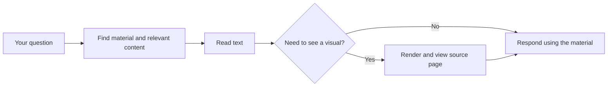
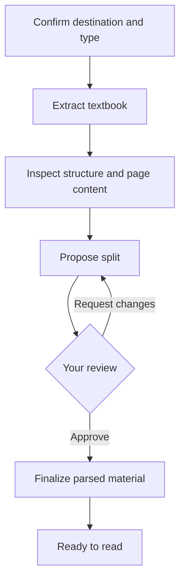

# Course material parser

[English](README.md) | **繁體中文**

一個在本機執行的 agent skill，讓 AI agent 閱讀課程教科書與講義投影片，
包括你想討論的頁面、圖表與公式。

## 🌟 Highlights

- **只讀取需要的內容。** 依章節或 reading unit（閱讀單元）瀏覽教科書，
  依來源頁面讀取投影片，不必將整份 PDF 載入對話。
- **不只讀文字，也能查看頁面。** Agent 可以將來源頁面 render 成圖片，
  搭配解析後的內容，查看示意圖、圖表與其他視覺內容。
- **建立可重複使用的 course library。** PDF 只需解析一次，之後提問或學習時，
  都能回來讀取已儲存的教材。
- **在本機處理。** PDF 轉換與 page rendering 都在你的電腦上執行；
  完成模型設定後，解析不需要網路連線。

## ℹ️ Overview

這個 skill 協助 agent 運用課程教材：尋找教科書或投影片、閱讀相關內容，
並在需要理解視覺內容時查看來源頁面。它使用
[Docling](https://github.com/docling-project/docling) 將來源 PDF 轉換為解析後教材，
保留文字、結構，以及視覺內容的參照。教科書會經你核准後整理成章節與 reading units；
投影片則可依來源頁面讀取。

## 🚀 Usage

安裝完成後，就可以請 agent 閱讀 library 中的教材：

> 閱讀我的經濟學教科書第 1.1 節，解釋所得如何影響需求。

> 顯示第 1 章的供需圖，並解釋圖中的曲線。

> 閱讀講義投影片的第 8–12 頁，整理重點。

Agent 會找到教材、查看目錄，並讀取相關章節、reading units 或投影片。
需要查看視覺內容時，它會將來源頁面 render 成圖片並檢視。
頁碼一律指來源 PDF 從 1 開始計算的實際頁面，而不是 PDF 上印出的頁碼。



### 將 PDF 加入 library

> 將 `~/courses/economics/textbook.pdf` 解析到我的 course library。

Agent 會建議儲存位置與教材類型，請你確認。投影片解析完成後即可閱讀。
教科書則會先檢查擷取出的結構，擬定 split plan（拆分計畫），
再提出 split proposal（拆分提案），讓你審核章節與 reading units 的安排。

以下是解析後教材的組織方式範例：

```text
economics/textbook
├── 第 1 章：供給與需求
│   ├── 導論
│   ├── 1.1 需求
│   ├── 1.2 供給
│   └── 習題
├── 第 2 章：彈性
│   ├── 導論
│   ├── 2.1 需求價格彈性
│   ├── 2.2 所得彈性與交叉價格彈性
│   └── 習題
├── 第 3 章：消費者選擇
│   ├── 3.1 預算限制
│   ├── 3.2 偏好
│   ├── 3.3 最適選擇
│   └── 習題
└── 第 4 章：生產與成本
    ├── 導論
    ├── 4.1 生產函數
    ├── 4.2 短期與長期成本
    └── 習題
```



回覆 **approve** 即可核准 split proposal，或描述想要的修改，讓 agent 重新提出提案。
規劃與修改 split plan 時不會重新轉換 PDF。只有在你明確要求時才會進行解析；
針對既有教材提問，不會觸發新的解析。

## ⬇️ Installation

> 也可以請你的 agent 閱讀這份 README，協助你完成安裝。

支援平台：**Apple Silicon macOS** 與 **Linux（x86_64、arm64）**。
需要 [uv](https://docs.astral.sh/uv/) 與 Python 3.12。

### 1. 讓 agent 載入 skill

下載或 clone 此 repo，並透過你使用的 agent 所提供的 skill 安裝機制，
將 repo 根目錄註冊為 skill。根目錄的 [SKILL.md](SKILL.md) 是 agent 的入口。
請保留完整目錄，包含 `scripts/` 與 `references/`。

### 2. 安裝 dependencies 並建立設定檔

在 skill 目錄（repo 根目錄）執行：

```sh
uv sync
cp settings.example.toml settings.toml
```

### 3. 設定 skill

選擇 library 的儲存目錄並建立它。請將 `<library_root>` 替換為你選擇的路徑：

```sh
mkdir -p <library_root>
```

編輯 `settings.toml`，將 `library_root` 設為相同路徑。
下方路徑僅為範例；以下列出所有支援的設定：

```toml
library_root = "~/course-library"
device = "cpu"
allow_ocr = true
combined_read_max_chars = 60000
```

| Key | Required / default | Purpose |
|---|---|---|
| `library_root` | Required | 解析後教材的儲存位置。必須是已存在目錄的絕對路徑，可使用 `~`。 |
| `device` | Required | 解析使用的硬體：Apple Silicon 使用 `"mps"`，配備 NVIDIA GPU 的 Linux 使用 `"cuda"`，所有支援的平台皆可使用 `"cpu"`。不會自動選擇。 |
| `allow_ocr` | Optional; `true` | 允許對掃描 PDF 使用 OCR。設為 `false` 可禁止在此電腦上使用 OCR。 |
| `combined_read_max_chars` | Optional; `60000` | 讀取整章的字元數上限。超過時，agent 必須明確確認需要讀取整章，才能繼續。個別 reading units 與投影片不受此限制。 |

### 4. 下載模型

```sh
uv run download-models
```

模型下載量約 **1.2 GB**；允許 OCR 時，另需約 **61 MB**。
此指令會驗證設定與 device、略過已存在的模型，且不會刪除模型。
修改 `device` 或 `allow_ocr` 後，請重新執行。

現在可以請 agent 閱讀 library 中的教材，或解析新的 PDF。

## Further documentation

以下文件目前以英文提供：

- [Configuration and runtime reference](docs/runtime-reference.md) — 設定驗證、device、
  模型儲存位置、OCR 行為與設定錯誤。
- [CLI reference](docs/cli-reference.md) — 支援此 skill 的 `parse` 與 `read` 工具。
- [Domain glossary](GLOSSARY.md) — 專案使用的詞彙。
- [Formula-engine decision](docs/adr/0001-formula-engines.md) — 實作選擇的理由與效能證據。

## 💭 Feedback and Contributing

發現 bug、有 feature request，或想改善文件？
歡迎[開 issue](https://github.com/chilfox/course-material-parser/issues)。
